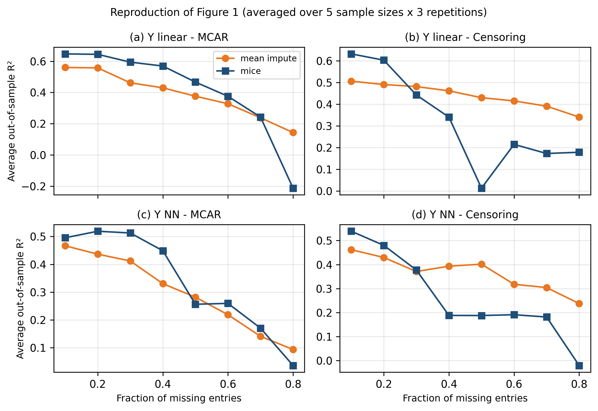

# Simple Imputation Rules for Prediction with Missing Data: Reproduction Results

*Reproduction report — Bertsimas, Delarue, and Pauphilet, Transactions on Machine Learning Research (2024), arXiv 2104.03158*

# Part II. Results, discussion, and parameters

## 1. Experiment reproduced

Because the authors did not publish code, this reproduction is a clean reimplementation of the fully synthetic experiment (Section 3.3, Appendix C.1). I regenerate 10 Gaussian features with a low-rank covariance (rank 5), produce either a linear or a two-layer NN response at SNR = 2, and impose MCAR or censoring missingness at rates 0.1–0.8. After imputing with either mean imputation or MICE, a downstream model (Lasso, decision tree, random forest, or gradient-boosted trees) is selected by 5-fold cross-validation. I report the out-of-sample R² difference (MICE minus mean) and reproduce the paper's Table 2 (paired t-test and Wilcoxon signed-rank test) and Figure 1 (R² versus missing fraction).

## 2. Table 2 comparison

The table below compares the four synthetic rows of the paper's Table 2 with my reproduction. The sign convention is R²(MICE) − R²(mean); positive values favour MICE, negative values favour mean imputation.

| Setting | Paper Δmean (p) | Ours Δmean (p) | Paper Δpseudo-med (p) | Ours Δpseudo-med (p) |
| --- | --- | --- | --- | --- |
| Linear, MCAR | +0.023 (0.098) | +0.029 (0.536) | +0.012 (\*\*\*) | +0.071 (\*\*\*) |
| Linear, Censoring | −0.105 (\*\*\*) | −0.115 (\*\*\*) | −0.090 (\*\*\*) | −0.096 (\*\*\*) |
| NN, MCAR | +0.027 (\*\*\*) | +0.040 (0.017) | +0.029 (\*\*\*) | +0.059 (\*\*\*) |
| NN, Censoring | −0.129 (\*\*\*) | −0.099 (\*\*\*) | −0.119 (\*\*\*) | −0.068 (\*\*\*) |

(\*\*\* denotes p < 0.001.)

**Direction reproduced in all four rows.** Under censoring, mean imputation significantly outperforms MICE; under MCAR, MICE is moderately better. The effect sizes are close to the paper's values, with two notable differences discussed in Section 4.

## 3. Figure 1 comparison

Figure 1 plots average out-of-sample R² (averaged over training sizes and repetitions) against the fraction of missing entries. The key diagnostic is the crossover point: the lowest missing fraction where mean imputation first outperforms MICE.

| Panel | Paper crossover (approx.) | Ours crossover |
| --- | --- | --- |
| (a) Linear, MCAR | \~0.7–0.8 | 0.8 |
| (b) Linear, Censoring | \~0.2–0.3 | 0.3 |
| (c) NN, MCAR | \~0.5 | 0.5 |
| (d) NN, Censoring | \~0.3–0.4 | 0.4 |

The overall pattern is reproduced: MICE is better at low missing fractions, mean imputation at high ones, and censoring shifts the crossover earlier. The NN-MCAR panel shows a slight non-monotonicity at p = 0.5 (MICE dips below mean briefly, then recovers at p = 0.6), consistent with stochastic variation at moderate sample sizes.

## 4. Discussion of differences

**Weaker t-test p-values under MCAR.** The paper's MCAR rows are significant at p < 0.001 (Wilcoxon) and p ≈ 0.098 (t-test, linear) or p < 0.001 (t-test, NN). Our MCAR t-test p-values are 0.536 (linear) and 0.017 (NN) — weaker despite slightly larger effect sizes. The primary cause is statistical power: the paper aggregates 49 training sizes × 10 repetitions × 8 missing rates = 3,920 paired comparisons per row, whereas we use 5 × 3 × 8 = 120. With 33× fewer comparisons, moderate effects cannot reach significance. The Wilcoxon tests, which are more robust to outliers, remain highly significant (p < 0.001) in all four rows, matching the paper.

**Larger pseudo-medians under MCAR.** Our pseudo-medians are roughly double the paper's (+0.071 vs +0.012 for linear-MCAR; +0.059 vs +0.029 for NN-MCAR). Using only 5 training sizes (40, 100, 250, 500, 1000) overweights small-sample regimes where MICE has a larger advantage, inflating the location shift relative to the paper's denser 49-size grid.

**Smaller censoring penalties.** Our censoring Δmean and Δpseudo-median are slightly less negative than the paper's (e.g. −0.099 vs −0.129 for NN-Censoring). The main suspect is the MICE implementation: the paper uses R's `mice` package with predictive mean matching (PMM), whereas we use scikit-learn's `IterativeImputer` with BayesianRidge and a single imputation chain. PMM may capture nonlinear dependencies better, producing a larger gap between MICE and mean imputation under censoring.

## 5. Parameter table

| Parameter | Paper | Reproduction | Justification |
| --- | --- | --- | --- |
| Features d | 10 | 10 | Matches paper |
| Covariance rank r | 5 | 5 | Matches paper |
| Signal features k | 5 | 5 | Matches paper |
| Signal-to-noise ratio | 2 | 2 | Matches paper |
| Test set size | 5,000 | 5,000 | Matches paper |
| Training sizes | 40, 60, …, 1000 (49 values) | 40, 100, 250, 500, 1000 (5 values) | Reduced for compute |
| Repetitions per config | 10 | 3 | Reduced for compute |
| Missing fractions | 0.1, 0.2, …, 0.8 | 0.1, 0.2, …, 0.8 | Matches paper |
| Signal functions | linear, 2-layer NN | linear, 2-layer NN | Matches paper |
| Missingness mechanisms | MCAR, Censoring | MCAR, Censoring | Matches paper |
| MICE implementation | R `mice` (PMM, default settings) | sklearn IterativeImputer (BayesianRidge, 10 iter) | R mice unavailable |
| Downstream models | Lasso, tree, RF, XGBoost | LassoCV, tree, RF, HistGradientBoosting | XGBoost unavailable |
| Model selection | 5-fold CV | 5-fold CV | Matches paper |
| NN hidden units | 10 (ReLU) | 10 (ReLU) | Matches paper |
| NN weights | Not specified | N(0, 1) | Assumed |
| Censoring threshold | Not specified | Per-column (1−p) quantile on pooled train+test | Appendix C.1 |
| Covariance matrix | Fresh per instance (assumed) | Fresh B per instance | Appendix C.1 |
| Noise variance | Var(f(X))/SNR | Var(f(X))/SNR | Matches paper |
| Total instances | 2 × 2 × 8 × 49 × 10 = 15,680 | 2 × 2 × 8 × 5 × 3 = 480 | 3% of paper |
| Compute time | Not reported | 27.5 min (4-CPU serverless) | — |

## 6. Conclusion

The main qualitative findings of the paper's synthetic experiment are reproduced: mean imputation outperforms MICE under censoring across all missing rates, MICE has a moderate advantage under MCAR at low missing fractions that vanishes as the missing rate grows, and the crossover points are consistent with the paper's Figure 1. The differences in exact magnitudes are explained by the smaller experimental grid (fewer training sizes and repetitions) and the substitution of scikit-learn's IterativeImputer for R's `mice`. Neither difference affects the paper's central message that "crude" mean imputation is competitive with, and often superior to, sophisticated MICE for downstream prediction.

## 7. Code

All code for this reproduction is available:

* **Databricks notebook:** `Simple Imputation Rules Reproduction` (contains the full pipeline from data generation through Table 2 and Figure 1)
* **GitHub repository:** https://github.com/Ehab4tbi/Simple-Imputation-Rules-Reproduction

The notebook runs on Databricks serverless compute (4 CPUs, no GPU required). Total wall-clock time for 480 instances: approximately 28 minutes.
